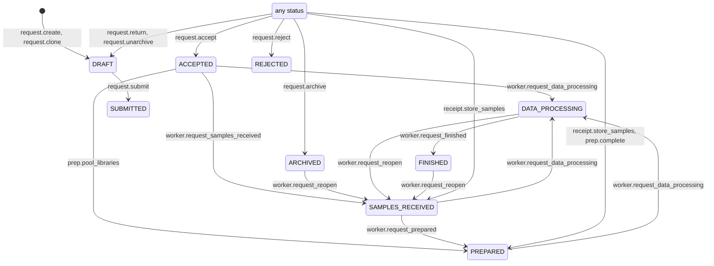
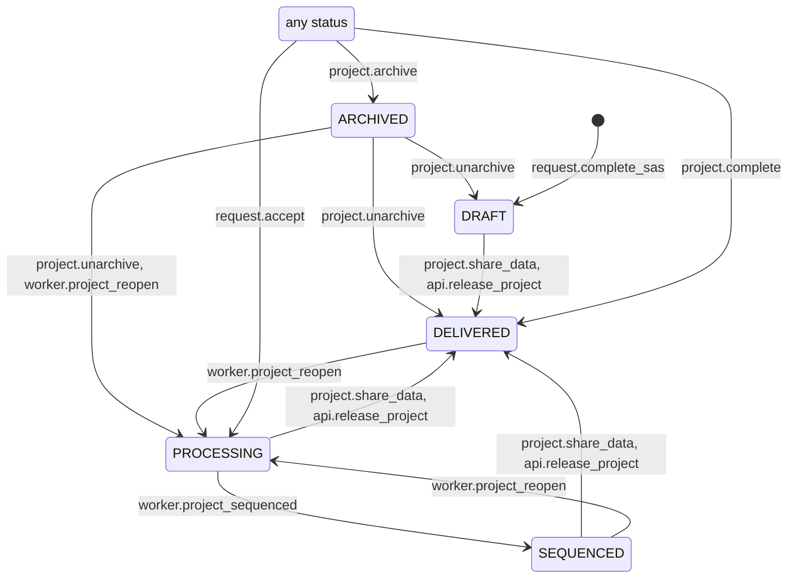
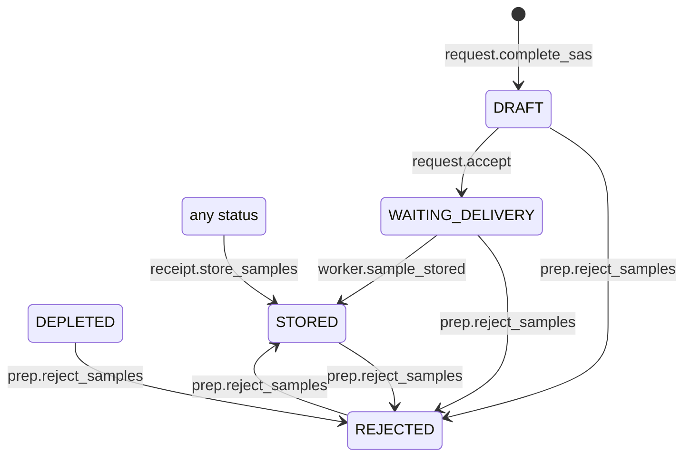
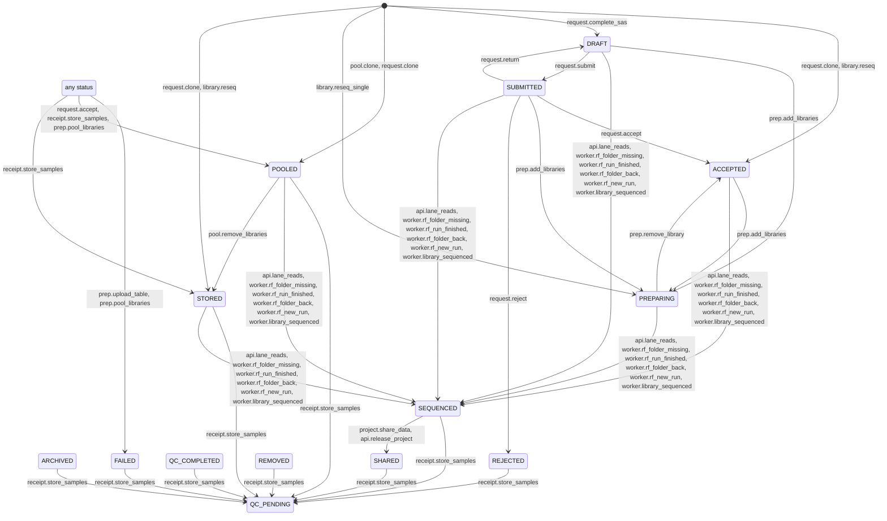
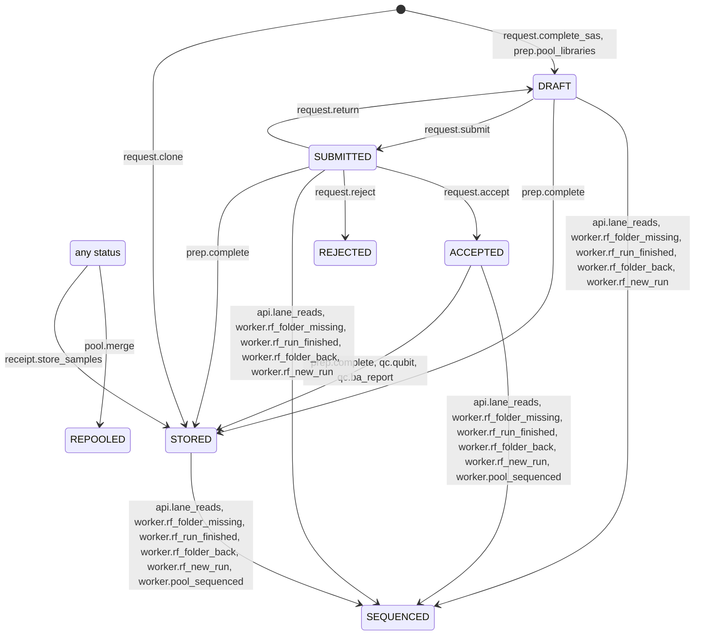
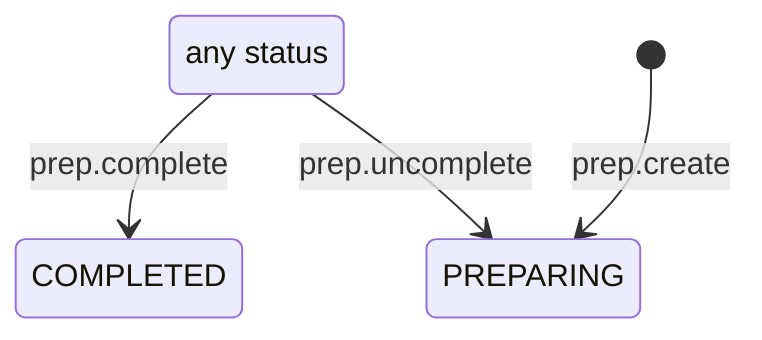
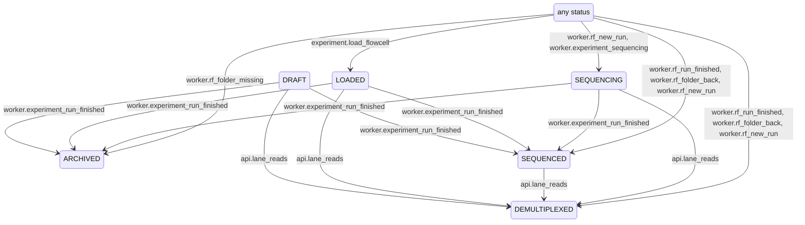
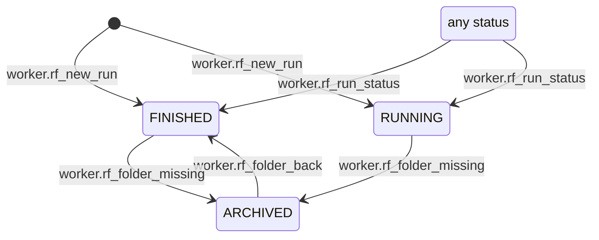
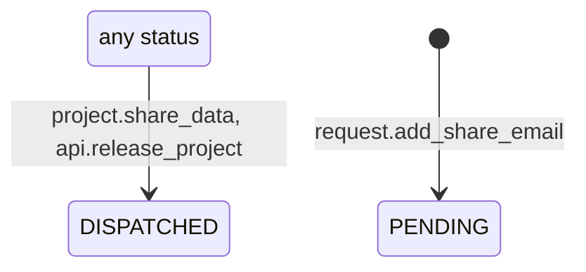

# State Transitions

How statuses of requests, projects, samples, libraries, pools, lab preps, experiments, seq runs and delivery emails change: which operations change them, under which conditions, and which ways lead to the next status.

- [Overview](#overview)
- [Concepts](#concepts)
- [Example: three ways to PREPARED](#example-three-ways-to-prepared)
- [Status history](#status-history)
- [Modes, reasons and database enforcement](#modes-reasons-and-database-enforcement)
- [Existing data](#existing-data)
- [Status tab](#status-tab)
- [How to …](#how-to-)
- [Entities and states](#entities-and-states) *(generated)*
- [Operations](#operations) *(generated)*
- [Routes](#routes) *(generated)*
- [Known gaps](#known-gaps) *(generated)*
- [Limitations](#limitations)
- [Code](#code)

## Overview

Statuses change in many places: actions and workflows in the web app, model edit forms, API calls, and two worker tasks (`update_statuses` and the run folder scanner) that cascade statuses every few minutes. The **transition registry** in `opengsync_db.transitions` declares all of them in one place, as typed data:

- **what** can change: per entity, which status can move to which, and through which operation;
- **how**: every operation that changes statuses, with all the entities it touches, including cascades to libraries, pools, requests and projects;
- **when**: guards (preconditions) as rules that can explain why they don't hold, e.g. *"3 libraries of the request below POOLED (2 ACCEPTED, 1 STORED)"*;
- **which ways**: when several operations lead to the same status, all of them are listed, so you can pick the one that fits.

Every status change is also **recorded**: who changed what, when, through which operation, and why. See [Status history](#status-history).

The registry describes the **current** behaviour, including behaviour that looks wrong. Those places carry a `gap` note and are listed under [Known gaps](#known-gaps). A gap is fixed by changing the code and the declaration in the same commit.

The second half of this document is generated from the registry and kept in sync by a test. Edit the registry, not the generated part.

## Concepts

| Concept | What it is | Where |
|---|---|---|
| **Entity** | A model with a status column, e.g. `library`. Also lists statuses that are only set by hand (`manual_only`) or never set (`unused`). | `entities.py` |
| **Operation** | Something that changes statuses: an action, workflow, API call, worker rule, manual edit or migration. Has an id like `prep.pool_libraries`, a kind, the entity it is started from (subject), its effects, an optional guard, and a reason template for automatic kinds. | `operations/*.py` |
| **Effect** | One change an operation can make: `Library: ACCEPTED → POOLED via libraries`, optionally with a condition (`when`) and a `gap`. `any` means the source status is not checked; `chosen` means the user picks the new status; `new` means the record is created. | `core.py` |
| **Rule** | A precondition that evaluates against the database and returns the blocking items when it does not hold. Rules count children per status in one `GROUP BY` per relation. | `rules.py`, `relations.py` |
| **Route** | A named path through operations for one kind of request (raw samples, pre-pooled, un-pooled, QC only, re-sequencing). Each step lists the operations that complete it and a rule that says when it is done; steps can be optional. | `routes.py` |

**State graph.** The graph of an entity is not declared separately: it is the union of the effects of all actions, workflows, API calls and worker rules. Manual edits, chosen statuses and migrations are not part of the graph. Every status must be reachable through the graph, or be listed as `manual_only` or `unused` with a reason; the registry validation checks this.

**Status order.** The legacy code compares statuses by id (`library.status < LibraryStatus.POOLED`). Terminal statuses have ids ≥ 10 (FAILED, REJECTED, ARCHIVED), so they count as "beyond" every normal status. The registry reproduces this exactly with `below(X)` and `at_least(X)`.

**Route of a request.** `routes.infer_route()` picks the route from the submission type. A request with open re-sequenced libraries next to sequenced ones gets the re-sequencing route.

## Example: three ways to PREPARED

`registry().operations_reaching(entities.SEQ_REQUEST, SeqRequestStatus.PREPARED)` returns:

| Operation | When |
|---|---|
| `receipt.store_samples` | Pooled-library submissions: all pools of the request are stored. |
| `prep.pool_libraries` | Pooling workflow of a lab prep: the request is ACCEPTED and all its libraries are POOLED or beyond. |
| `prep.complete` | Completing a lab prep: all libraries of the request are POOLED or beyond (no check on the request's status). |
| `worker.request_prepared` | Automatically, every few minutes: the request is SAMPLES_RECEIVED and all its libraries are POOLED or beyond. |

The worker rule has a guard, so the registry can say why it hasn't happened yet:

```python
from opengsync_db.transitions import registry, rules

op = registry()["worker.request_prepared"]
verdict = op.guard.evaluate(rules.Snapshot(session), seq_request)
verdict.holds             # False
verdict.blockers[0].text  # '2 libraries of the request below POOLED (1 ACCEPTED, 1 STORED)'
```

## Status history

Code that changes statuses runs inside an operation:

```python
from opengsync_db.transitions import run_operation, lab

with run_operation(session, lab.POOL_LIBRARIES, subject=lab_prep):
    library.status = LibraryStatus.POOLED
    ...
```

A flush hook on the SQLAlchemy session (`tracking.py`) looks at the status attribute of every new and changed record and writes:

| Table | One row per | Columns |
|---|---|---|
| `operation_run` | execution of an operation (created on its first change) | `operation` (id), `kind`, `actor_id`, `subject_type` / `subject_id`, `parent_run_id`, `comment`, `reason`, `inferred`, `timestamp_utc` |
| `status_change` | changed record | `run_id`, `entity_type` (table name), `entity_id`, `entity_key`, `from_status`, `to_status`, `declared`, `inferred`, `detail`, `txid`, `timestamp_utc` |

- **Same transaction.** Rows are written with plain SQL inserts on the session's connection: a rollback discards them, and they never show up in the unit of work or the [audit log](audits.md).
- **Creation** is recorded as `from_status = NULL`. Records created without a status (samples of pooled submissions) are not recorded. **Deletes** are not recorded.
- **Setting the same status** writes nothing, so worker rules that re-set a status every few minutes leave no trace.
- **Statuses** are stored as enum ids (`to_status = 5` is `LibraryStatus.POOLED` for `entity_type = 'library'`).
- **Delivery emails** have a composite key: `entity_id` is the request id and `entity_key` the email address.
- **Nested operations** (an action calling a shared function that runs its own operation) get their own run with `parent_run_id` pointing at the outer one.
- **`detail`**: `op.detail(record, "text")` inside the block attaches a note to that record's change, e.g. the run folder or the experiment that triggered it.
- **`declared`** is false when the operation does not declare the change (see [modes](#modes-reasons-and-database-enforcement)).

**Actor.**

| Where | Actor |
|---|---|
| Web app (cookie login) | the logged-in user: `get_user_id` sets it as the session's default actor (`tracking.set_actor`) |
| REST API (`X-API-Token`) | the token's owner |
| Worker | none |
| Migrations | none |
| `run_operation(..., actor_id=...)` | the given user (overrides the default) |

**Comment and reason.** `comment` is the user's optional note: the edit forms of pools, projects, libraries, samples, experiments and seq runs show a "Why? (optional)" field next to the status for users who may change it. It is stored only when the status actually changes. `reason` is the system's explanation: worker, migration and system runs must have one, rendered from the operation's template (`"run folder {folder} no longer exists"`) or passed as `reason=`.

**Querying.** History of one library:

```sql
SELECT sc.timestamp_utc, r.operation, r.kind_id, u.email AS actor, sc.from_status, sc.to_status, r.reason, r.comment, sc.detail
FROM status_change sc
JOIN operation_run r ON r.id = sc.run_id
LEFT JOIN lims_user u ON u.id = r.actor_id
WHERE sc.entity_type = 'library' AND sc.entity_id = 1234
ORDER BY sc.timestamp_utc, sc.id;
```

Everything one operation run changed:

```sql
SELECT entity_type, entity_id, from_status, to_status, detail FROM status_change WHERE run_id = 42 ORDER BY id;
```

Code paths that still change statuses outside an operation:

```sql
SELECT reason, count(*) FROM operation_run WHERE operation = 'system.unattributed' GROUP BY reason ORDER BY count(*) DESC;
```

## Modes, reasons and database enforcement

**Unattributed changes.** A status change outside any `run_operation` block is still recorded, under the operation `system.unattributed` with kind SYSTEM and the reason `no operation context at <module>:<function>:<line>`: the first code location outside SQLAlchemy where the flush happened. That points at the code path that needs wrapping.

**Modes.** `session.info["transitions.mode"]` decides what happens with an unattributed change, or a change the running operation does not declare:

| Mode | Rows written | Logged | Raises | Used for |
|---|---|---|---|---|
| `record` | yes | no | no | test setup (the `session` fixture) |
| `warn` | yes | once per code location | no | **default**: web app, worker |
| `strict` | — | — | `UndeclaredTransition` | sessions the app opens in tests, and worker tests |

The default comes from the environment variable `OPENGSYNC_TRANSITIONS_MODE`, else `warn`. A handler can set it for all its sessions: `SyncDBHandler(session_info={"transitions.mode": "strict"})`. There is no "off" mode: the database requires a history row for every status change.

**Database enforcement.**

1. **Reasons.** The CHECK constraint `ck_operation_run_reason` rejects worker, migration and system runs (`kind_id` 10, 11, 12) without a non-blank reason.
2. **No status change without history.** Every status column has a deferred constraint trigger (`trg_<table>_status_history`, function `assert_status_history()`). At commit it checks that each status change of the transaction has a `status_change` row with the same record, the new status and the same transaction id (`txid`). If not, the commit fails:

   ```
   status change without history row: library.status_id of 1234 -> 5
   HINT: Change statuses through the ORM (opengsync_db.transitions) or with record_bulk_status_change().
   ```

   This catches raw SQL, psql sessions and code paths that bypass the ORM. Updates that keep the status, inserts without a status, and deletes are not checked.

**Changing statuses with SQL** (maintenance scripts; data migrations copy its SQL, see [How to …](#how-to-)): use `record_bulk_status_change`, which updates the rows and writes the history in one statement:

```python
from opengsync_db.transitions import entities
from opengsync_db.transitions.sql import record_bulk_status_change

record_bulk_status_change(
    op.get_bind(), entities.LIBRARY, "t.lab_prep_id IS NOT NULL AND t.status_id < 3", 3,
    operation="migration.restore_preparing", reason="library is in a lab prep",
)
```

## Existing data

Status history starts with migration `b7c41e9d2f30`. What happened before is unknown, and nothing is made up:

- **Baseline.** Every record with a status gets one change `NULL → current status`, under one `migration.baseline` run (kind MIGRATION, no actor), timestamped at migration time.
- **Inferred changes** (migration `c3e8f1a6b905`, can be reverted on its own). Existing timestamp columns tell part of the story; these are recorded under one `migration.inferred` run with `inferred = true`, the original timestamp and an unknown previous status:

  | Source | Inferred change |
  |---|---|
  | `seq_request.timestamp_submitted_utc` | → SUBMITTED |
  | `sample` / `library` / `pool`.`timestamp_stored_utc` | → STORED |
  | `experiment` / `project`.`timestamp_created_utc` | → DRAFT |
  | `seq_run.timestamps` `started` / `completed` | → RUNNING / FINISHED |

  `seq_request.timestamp_finished_utc` and `experiment.timestamp_finished_utc` are never written, so they are not used.
- **Restored PREPARING** (migration `d5a7c3e9f142`). Adding libraries to a lab prep stopped setting them to PREPARING in commit `d9685235` (2026-06-10); it does again, and this migration sets libraries already in a lab prep below PREPARING to PREPARING, recorded under `migration.restore_preparing`. The downgrade does not revert it.
- **Consistency report.** `python -m opengsync_db.transitions.consistency` (with the `POSTGRES_*` environment variables) lists records whose status contradicts their children, e.g. PREPARED requests with libraries below POOLED, or libraries in a lab prep that are not PREPARING. It only reports; nothing is changed.

## Status tab

Staff see a **Status** tab on request, project, lab prep and experiment pages (`GET /htmx/status/{entity}/{id}`, built by `transitions.status.build()`):

| Section | Shows | Comes from |
|---|---|---|
| Now and next | One read-only panel; actions are started from the page itself (e.g. after its checklist), not from the tab. The current status as a filled pill and an arrow to what comes next as a dashed pill (for requests the current step of the route, for other records the nearest status ahead). For requests, the route's steps as a segmented bar (green done, blue current, grey upcoming, faded skipped optional steps); the cog in the corner shows the route's name and opens a menu to pin another route or let it be inferred again. Below, what the next step waits for: counts of related records as progress bars ("Libraries ▓▓▓░ 865/918 · 53 stored still", the full text and the ids on hover / click), other conditions as one line each, automatic ways (⚙) and ways from other pages (↗) as one line each. | `routes.py`, `seq_request.route_override`, operation `manual.set_route`; `StatusReport.next_*`, guards |
| Status chart *(requests)* | The record's statuses as cards and the actions between them as edges (React Flow). The main statuses form one row in their order, side states (rejected, failed, archived, …) a row below. Neighbouring statuses are joined by short arrows; every other edge runs in its own lane, forward jumps above the row and backward edges and edges to/from side states below, so edges and labels never overlap. By default the chart is focused: the main path, the actions leaving the current status (labelled: green possible now, red dotted blocked, blue dashed automatic, grey done from another page) and the transitions the record took (dark). "All transitions" adds every other declared transition, unlabelled. Hovering an edge lists its actions, what blocks them and what they do to other records. Actions that don't check the source status start where their guard allows them (accept: from SUBMITTED); without a guard (archive) they are only drawn from the current status. Unchecked side effects of actions on other records (completing a lab prep sets the request PREPARED) are only drawn when they are a way to the record's next step. Manual edits are not shown. | `transitions.statechart.build()` (`GET /htmx/status/{entity}/{id}/statechart`), `static/js/status-graph.js` |
| Contents board *(projects, experiments, lab preps)* | Their own statuses are coarse or set by the status worker, so instead of the chart these pages show a read-only kanban of their contents: a project's requests, an experiment's pools, a lab prep's libraries. One column per main status (from the first relevant one: requests from SUBMITTED, pools from STORED, libraries from PREPARING; earlier ones only when occupied), side states in one "Other" column. Cards link to the record and show how many days it has been in its status (only when the history knows; the migration baseline doesn't count) and a detail: request library progress ("18/24 libraries sequenced") and its next step, pool library count and lanes, library pool (libraries grouped by request). At most 40 cards per column, the rest are counted. | `transitions.kanban.build()`, `templates/components/status/kanban.html` |
| Other status changes *(collapsed)* | Everything else that could happen now, as text (archive, reject, worker rules, ways from other pages). Changes that don't apply to the current status at all (e.g. unarchive a submitted request) are left out. | `StatusReport.other_ways` |
| History *(collapsed, loaded when opened)* | Every run that changed the record or was started from it: from → to, operation, time, actor or *automatic*, comment and reason. Changes of related records in the same run are counted behind "+N related changes"; migrations show none. | `transitions.status.history()` (`GET /htmx/status/{entity}/{id}/history`) |

## How to …

**Change what an operation does.** Change the code and its declaration in `operations/*.py` in the same commit, then regenerate this document. If the change fixes a gap, remove the `gap=` note.

**Add an operation.**
1. Declare it in the module of its area with `operation(id, label, kind, subject, *effects, guard=..., reason=..., where=[...])`. Ids are `area.verb_object`, at most 64 characters, and must never be reused for something else.
2. Worker, migration and system operations need a `reason` template (e.g. `"run folder {folder} no longer exists"`).
3. Regenerate this document and run the registry tests.

**Wrap a code path.** Wrap the route, action or function body that changes statuses in `with run_operation(session, <operation>, subject=...)`, not each assignment. Pass `comment=` for user notes, and for worker operations the keys of the reason template. Find unwrapped paths with the unattributed query in [Status history](#status-history).

**Write a data migration that changes statuses.** A plain `UPDATE ... SET status_id` fails at commit: the migration must write the history in the same transaction. Copy the SQL of `record_bulk_status_change` into the migration (see `d5a7c3e9f142_restore_library_preparing.py`) instead of importing it: alembic loads every revision file, also in a migrator image with an older `opengsync_db`, so migrations must not import package code. Maintenance scripts can call `record_bulk_status_change` directly.

**Rename an operation id.** Ids are stored in `operation_run.operation`. Rename them in a data migration (`UPDATE operation_run SET operation = 'new.id' WHERE operation = 'old.id'`) in the same release.

**Add a status to an enum.** Declare which operation sets it, or list it in the entity's `manual_only` or `unused`. Otherwise the registry validation fails.

**Add a route or a step.** Edit `routes.py`. A step's `alternatives` must be registered operation ids.

**Regenerate this document.**

```bash
python -m opengsync_db.transitions.docs --write   # update the generated part
python -m opengsync_db.transitions.docs --check   # exit 1 if out of date
```

<!-- BEGIN GENERATED: transitions (python -m opengsync_db.transitions.docs --write) -->

## Entities and states

Diagrams show process edges only: actions, workflows, API calls and worker rules. Manual edits (any → any), chosen statuses and migrations are listed in the operations table.

### Request

Table `seq_request`, enum `SeqRequestStatus`.

| Status | Id | Description | Set by |
|---|---|---|---|
| DRAFT | 0 | Request is in its planning stage | `request.create`, `request.clone`, `request.return`, `request.unarchive` |
| SUBMITTED | 1 | Request is submitted for validation | `request.submit` |
| ACCEPTED | 2 | Request is accepted and waiting for samples to be delivered | `request.accept` |
| SAMPLES_RECEIVED | 3 | All samples are received and stored | `receipt.store_samples`, `worker.request_reopen`, `worker.request_samples_received` |
| PREPARED | 4 | All libraries are prepared and pooled, ready for sequencing | `receipt.store_samples`, `prep.pool_libraries`, `prep.complete`, `worker.request_prepared` |
| DATA_PROCESSING | 5 | All libraries are sequenced and being processed | `worker.request_data_processing` |
| FINISHED | 6 | Sequencing data is shared with the requestor | `worker.request_finished` |
| FAILED | 10 | Request failed | ⚠️ never set anywhere |
| REJECTED | 11 | Request was rejected | `request.reject` |
| ARCHIVED | 12 | Request was archived | `request.archive` |



### Project

Table `project`, enum `ProjectStatus`.

| Status | Id | Description | Set by |
|---|---|---|---|
| DRAFT | 0 | Project has been created but no samples have been submitted for sequencing. | `request.complete_sas`, `project.unarchive` |
| PROCESSING | 1 | Project is being worked on in the lab. | `request.accept`, `project.unarchive`, `worker.project_reopen` |
| SEQUENCED | 2 | All libraries are sequenced. We are working on data processing. | `worker.project_sequenced` |
| DELIVERED | 3 | Project is completed and data is delivered. | `project.share_data`, `api.release_project`, `project.complete`, `project.unarchive` |
| ARCHIVED | 11 | Data is archived. | `project.archive` |



### Sample

Table `sample`, enum `SampleStatus` (nullable).

| Status | Id | Description | Set by |
|---|---|---|---|
| DRAFT | 0 | Draft plan of the sample | `request.complete_sas` |
| WAITING_DELIVERY | 1 | Waiting for delivery | `request.accept` |
| STORED | 2 | Sample specimen was received from customer and stored | `receipt.store_samples`, `prep.reject_samples`, `worker.sample_stored` |
| DEPLETED | 10 | Sample specimen was depleted | by hand only (edit form or chosen status) |
| REJECTED | 11 | Sample failed during library preparation and is excluded from further processing | `prep.reject_samples` |



### Library

Table `library`, enum `LibraryStatus`.

| Status | Id | Description | Set by |
|---|---|---|---|
| DRAFT | 0 | Draft plan of the library | `request.complete_sas`, `request.return` |
| SUBMITTED | 1 | Submitted plan with sequencing request for review | `request.submit` |
| ACCEPTED | 2 | Library plan was accepted for sequencing | `request.clone`, `library.reseq`, `request.accept`, `prep.remove_library` |
| PREPARING | 3 | Library is being prepared for sequencing | `library.reseq_single`, `prep.add_libraries` |
| STORED | 4 | Library is received and stored | `request.clone`, `library.reseq`, `receipt.store_samples`, `pool.remove_libraries` |
| POOLED | 5 | Library is prepared and pooled and ready for sequencing | `pool.clone`, `request.clone`, `request.accept`, `receipt.store_samples`, `prep.pool_libraries` |
| SEQUENCED | 6 | Sequencing is finished | `api.lane_reads`, `worker.rf_folder_missing`, `worker.rf_run_finished`, `worker.rf_folder_back`, `worker.rf_new_run`, `worker.library_sequenced` |
| SHARED | 7 | Sequencing data is shared with the customer(s) | `project.share_data`, `api.release_project` |
| FAILED | 10 | Sequencing of the library could not be completed | `prep.upload_table`, `prep.pool_libraries` |
| REJECTED | 11 | Library was not accepted to be sequenced by staff | `request.reject` |
| ARCHIVED | 12 | Library is sequenced and the data is archived | by hand only (edit form or chosen status) |
| REMOVED | 13 | Library was removed | by hand only (edit form or chosen status) |
| QC_PENDING | 14 | Library is awaiting quality control | `receipt.store_samples` |
| QC_COMPLETED | 15 | Quality control is completed for the library | by hand only (edit form or chosen status) |



### Pool

Table `pool`, enum `PoolStatus`.

| Status | Id | Description | Set by |
|---|---|---|---|
| DRAFT | 0 | Draft plan of the pool | `request.complete_sas`, `request.return`, `prep.pool_libraries` |
| SUBMITTED | 1 | Pool is submitted for review by a customer | `request.submit` |
| ACCEPTED | 2 | Pool is accepted and waiting to be handed over for sequencing | `request.accept` |
| STORED | 3 | Pool is stored and ready for sequencing | `request.clone`, `receipt.store_samples`, `prep.complete`, `qc.qubit`, `qc.ba_report` |
| SEQUENCED | 4 | Pool is sequenced | `api.lane_reads`, `worker.rf_folder_missing`, `worker.rf_run_finished`, `worker.rf_folder_back`, `worker.rf_new_run`, `worker.pool_sequenced` |
| REJECTED | 10 | Pool was not accepted to be sequenced by staff | `request.reject` |
| ARCHIVED | 11 | Pool is sequenced and the data is archived | by hand only (edit form or chosen status) |
| REPOOLED | 12 | Pool is combined with other pool(s) | `pool.merge` |



### Lab prep

Table `lab_prep`, enum `PrepStatus`.

| Status | Id | Description | Set by |
|---|---|---|---|
| PREPARING | 0 |  | `prep.create`, `prep.uncomplete` |
| COMPLETED | 1 |  | `prep.complete` |
| ARCHIVED | 10 |  | ⚠️ never set anywhere |



### Experiment

Table `experiment`, enum `ExperimentStatus`.

| Status | Id | Description | Set by |
|---|---|---|---|
| DRAFT | 0 | Draft plan of the experiment | by hand only (edit form or chosen status) |
| LOADED | 1 | Libraries are loaded on the flowcell | `experiment.load_flowcell` |
| SEQUENCING | 2 | Sequencing | `worker.rf_new_run`, `worker.experiment_sequencing` |
| SEQUENCED | 3 | Sequencing is finished | `worker.rf_run_finished`, `worker.rf_folder_back`, `worker.rf_new_run`, `worker.experiment_run_finished` |
| DEMULTIPLEXED | 4 | Data is demultiplexed and ready for analysis | `api.lane_reads`, `worker.rf_run_finished`, `worker.rf_folder_back`, `worker.rf_new_run` |
| ARCHIVED | 10 | Data is archived | `worker.rf_folder_missing`, `worker.experiment_run_finished` |
| FAILED | 11 | Experiment failed | by hand only (edit form or chosen status) |
| CANCELED | 12 | Experiment was canceled | by hand only (edit form or chosen status) |



### Seq run

Table `seq_run`, enum `RunStatus`.

| Status | Id | Description | Set by |
|---|---|---|---|
| IDLE | 0 |  | by hand only (edit form or chosen status) |
| RUNNING | 1 |  | `worker.rf_run_status`, `worker.rf_new_run` |
| FINISHED | 2 |  | `worker.rf_folder_back`, `worker.rf_run_status`, `worker.rf_new_run` |
| ARCHIVED | 10 |  | `worker.rf_folder_missing` |
| FAILED | 11 |  | by hand only (edit form or chosen status) |



### Delivery email

Table `seq_request_delivery_email_link`, enum `DeliveryStatus`.

| Status | Id | Description | Set by |
|---|---|---|---|
| PENDING | 0 |  | `request.add_share_email` |
| DISPATCHED | 1 |  | `project.share_data`, `api.release_project` |



## Operations

### Requests

| Operation | Kind | Effects | Guard / reason | Where |
|---|---|---|---|---|
| `request.create`<br>Create request | Action | Request: new → DRAFT | — | `services/backend/server/forms/models/SeqRequestForm.py` |
| `request.complete_sas`<br>Complete sample annotation sheet | Workflow | Project: new → DRAFT <sub>via `samples.project`</sub> — a new project is created<br>Sample: new → DRAFT <sub>via `samples`</sub> — raw-sample submissions; pooled-library submissions create samples without status<br>Library: new → DRAFT <sub>via `libraries`</sub><br>Pool: new → DRAFT <sub>via `pools`</sub> — pooled-library submissions | — | `services/backend/server/forms/workflows/library_annotation/CompleteSASForm.py` |
| `request.clone`<br>Clone request | Action | Request: new → DRAFT<br>Library: new → ACCEPTED, STORED, POOLED <sub>via `libraries`</sub> — POOLED (pooled), STORED (indexed), ACCEPTED (raw)<br>Pool: new → STORED <sub>via `pools`</sub> — pooled | — | `services/backend/server/routes/htmx/seq_requests.py`<br>`packages/opengsync-db/opengsync_db/core/actions.py` |
| `request.add_share_email`<br>Add delivery email | Action | Delivery email: new → PENDING <sub>via `delivery_email_links`</sub> | — | `services/backend/server/forms/actions/AddSeqRequestShareEmailAction.py` |
| `request.submit`<br>Submit request | Action | Request: DRAFT → SUBMITTED<br>Library: DRAFT → SUBMITTED <sub>via `libraries`</sub><br>Pool: DRAFT → SUBMITTED <sub>via `pools`</sub> | guard: status is DRAFT and request is submittable (auth form uploaded, libraries annotated) | `services/backend/server/forms/actions/SubmitSeqRequestAction.py`<br>`packages/opengsync-db/opengsync_db/core/actions.py:submit_seq_request` |
| `request.accept`<br>Accept request | Action | Request: any → ACCEPTED<br>Sample: DRAFT → WAITING_DELIVERY <sub>via `samples`</sub><br>Library: SUBMITTED → ACCEPTED <sub>via `libraries`</sub><br>Library: any → POOLED <sub>via `libraries`</sub> — library is in a pool ⚠️ no status check: can move SEQUENCED or FAILED libraries back to POOLED<br>Pool: SUBMITTED → ACCEPTED <sub>via `pools`</sub><br>Project: any → PROCESSING <sub>via `samples.project`</sub> ⚠️ no status check: re-opens DELIVERED or ARCHIVED projects | guard: status is SUBMITTED<br>⚠️ no check on the request's current status | `services/backend/server/forms/actions/ProcessSeqRequestAction.py`<br>`packages/opengsync-db/opengsync_db/core/actions.py:process_seq_request` |
| `request.return`<br>Return request for revision | Action | Request: any → DRAFT<br>Library: SUBMITTED → DRAFT <sub>via `libraries`</sub><br>Pool: SUBMITTED → DRAFT <sub>via `pools`</sub> | guard: status is SUBMITTED<br>⚠️ no check on the request's current status | `services/backend/server/forms/actions/ProcessSeqRequestAction.py`<br>`packages/opengsync-db/opengsync_db/core/actions.py:process_seq_request` |
| `request.reject`<br>Reject request | Action | Request: any → REJECTED<br>Library: SUBMITTED → REJECTED <sub>via `libraries`</sub><br>Pool: SUBMITTED → REJECTED <sub>via `pools`</sub> | guard: status is SUBMITTED<br>⚠️ no check on the request's current status | `services/backend/server/forms/actions/ProcessSeqRequestAction.py`<br>`packages/opengsync-db/opengsync_db/core/actions.py:process_seq_request` |
| `request.archive`<br>Archive request | Action | Request: any → ARCHIVED | DRAFT requests need WRITE access, all others INSIDER. | `services/backend/server/routes/htmx/seq_requests.py:archive_seq_request` |
| `request.unarchive`<br>Unarchive request | Action | Request: any → DRAFT ⚠️ no check that the request is ARCHIVED; previous status is lost | guard: status is ARCHIVED | `services/backend/server/routes/htmx/seq_requests.py:unarchive_seq_request` |

### Projects

| Operation | Kind | Effects | Guard / reason | Where |
|---|---|---|---|---|
| `project.create`<br>Create project | Action | Project: new → chosen — chosen status; non-insiders only DRAFT | — | `services/backend/server/forms/models/ProjectForm.py` |
| `project.share_data`<br>Share project data | Action | Project: < DELIVERED → DELIVERED — 'mark project delivered' is ticked, or all libraries ≥ SEQUENCED<br>Delivery email: any → DISPATCHED <sub>via `libraries.seq_request.delivery_email_links`</sub> — email is a recipient<br>Library: SEQUENCED → SHARED <sub>via `libraries`</sub> | Same statuses as api.release_project (shared function). | `services/backend/server/forms/actions/ShareProjectDataAction.py`<br>`packages/opengsync-db/opengsync_db/core/actions.py:release_project_data` |
| `project.complete`<br>Complete project | Action | Project: any → DELIVERED | guard: all libraries of the project are SHARED, FAILED, REJECTED, ARCHIVED | `services/backend/server/routes/htmx/projects.py:complete_project` |
| `project.archive`<br>Archive project | Action | Project: any → ARCHIVED | — | `services/backend/server/routes/htmx/projects.py:archive_project` |
| `project.unarchive`<br>Unarchive project | Action | Project: ARCHIVED → DRAFT, PROCESSING, DELIVERED — DRAFT without libraries, DELIVERED if all libraries are finished, else PROCESSING | guard: status is ARCHIVED | `services/backend/server/routes/htmx/projects.py:unarchive_project` |
| `project.split`<br>Split project | Workflow | Project: new, DRAFT, PROCESSING, SEQUENCED, DELIVERED, ARCHIVED → chosen — destination project gets the chosen status<br>Sample: any → chosen <sub>via `samples`</sub> — a duplicate sample takes the further-along status | — | `services/backend/server/forms/workflows/split_project/ConfirmSplitForm.py`<br>`packages/opengsync-db/opengsync_db/core/actions.py:split_project` |
| `project.merge`<br>Merge projects | Action | Sample: any → chosen <sub>via `samples`</sub> — a duplicate sample takes the further-along status | — | `services/backend/server/forms/actions/MergeProjectsAction.py`<br>`packages/opengsync-db/opengsync_db/core/actions.py:merge_projects` |

### Pools

| Operation | Kind | Effects | Guard / reason | Where |
|---|---|---|---|---|
| `pool.create`<br>Create pool | Action | Pool: new → chosen — chosen status; non-insiders only DRAFT | — | `services/backend/server/forms/models/PoolForm.py` |
| `pool.clone`<br>Clone pool | Action | Pool: new → chosen — chosen status, prefilled STORED (insiders)<br>Library: new → POOLED <sub>via `libraries`</sub> | — | `services/backend/server/forms/models/PoolForm.py` |
| `pool.merge`<br>Merge pools | Workflow | Pool: new → chosen — chosen status; prefilled with the shared status of the source pools<br>Pool: any → REPOOLED — source pools | Non-staff merges create a DRAFT pool. | `services/backend/server/forms/workflows/merge_pools/MergePoolsForm.py`<br>`packages/opengsync-db/opengsync_db/core/actions.py:merge_pools` |
| `pool.remove_libraries`<br>Remove libraries from pool | Action | Library: POOLED → STORED <sub>via `libraries`</sub> | guard: status is DRAFT | `services/backend/server/routes/htmx/pools.py:remove_library_from_pool`<br>`services/backend/server/routes/htmx/pools.py:remove_libraries_from_pool` |

### Sequencing

| Operation | Kind | Effects | Guard / reason | Where |
|---|---|---|---|---|
| `experiment.create`<br>Create experiment | Action | Experiment: new → chosen — chosen status | — | `services/backend/server/forms/models/ExperimentForm.py` |
| `experiment.load_flowcell`<br>Load flowcell | Action | Experiment: any → LOADED — every lane is loaded ⚠️ no status check: re-submitting can move a SEQUENCED or DEMULTIPLEXED experiment back to LOADED | — | `services/backend/server/forms/actions/load_flowcell/LoadFlowCellCombinedAction.py`<br>`services/backend/server/forms/actions/load_flowcell/LoadFlowCellSeparateAction.py` |

### Lab prep

| Operation | Kind | Effects | Guard / reason | Where |
|---|---|---|---|---|
| `prep.create`<br>Create lab prep | Action | Lab prep: new → PREPARING | — | `services/backend/server/forms/models/LabPrepForm.py` |
| `mux.sample_pooling`<br>Sample multiplexing (mux prep) | Workflow | Library: new → chosen <sub>via `libraries`</sub> — new multiplexed libraries copy the status of the library they replace | — | `services/backend/server/forms/actions/SamplePoolingAction.py` |
| `prep.add_libraries`<br>Add libraries to lab prep | Action | Library: < PREPARING → PREPARING <sub>via `libraries`</sub> | guard: status is PREPARING | `services/backend/server/forms/actions/LibraryPrepAction.py`<br>`packages/opengsync-db/opengsync_db/core/actions.py:add_libraries_to_prep` |
| `prep.remove_library`<br>Remove library from lab prep | Action | Library: PREPARING → ACCEPTED <sub>via `libraries`</sub> | guard: status is PREPARING | `services/backend/server/routes/htmx/lab_preps.py:remove_library_from_prep`<br>`packages/opengsync-db/opengsync_db/core/actions.py:remove_library_from_prep` |
| `prep.upload_table`<br>Upload library prep table | Action | Library: any → FAILED <sub>via `libraries`</sub> — pool column is 'x' | — | `services/backend/server/forms/actions/UploadLibraryPrepSpreadsheetAction.py` |
| `prep.reject_samples`<br>Reject samples | Action | Sample: < REJECTED → REJECTED <sub>via `libraries.sample_links.sample`</sub> — row marked 'x'<br>Sample: REJECTED → STORED <sub>via `libraries.sample_links.sample`</sub> — mark removed | — | `services/backend/server/forms/actions/RejectSamplesAction.py` |
| `prep.pool_libraries`<br>Pool libraries | Workflow | Pool: new → DRAFT <sub>via `pools`</sub> — existing pools of the prep are deleted and recreated<br>Library: any → FAILED <sub>via `libraries`</sub> — pool is 'x'<br>Library: any → POOLED <sub>via `libraries`</sub><br>Request: ACCEPTED → PREPARED <sub>via `libraries.seq_request`</sub> — all libraries of the request ≥ POOLED | guard: status is PREPARING | `services/backend/server/forms/workflows/library_pooling/CompleteLibraryPoolingForm.py` |
| `prep.complete`<br>Complete lab prep | Action | Pool: < STORED → STORED <sub>via `pools`</sub><br>Request: any → PREPARED <sub>via `libraries.seq_request`</sub> — all libraries of the request ≥ POOLED ⚠️ no status check: can move DATA_PROCESSING, FINISHED or ARCHIVED requests back<br>Lab prep: any → COMPLETED | guard: status is PREPARING | `services/backend/server/routes/htmx/lab_preps.py:complete_lab_prep` |
| `prep.uncomplete`<br>Reopen lab prep | Action | Lab prep: any → PREPARING | guard: status is COMPLETED | `services/backend/server/routes/htmx/lab_preps.py:uncomplete_lab_prep` |

### Libraries

| Operation | Kind | Effects | Guard / reason | Where |
|---|---|---|---|---|
| `library.reseq`<br>Re-sequence libraries | Action | Library: new → ACCEPTED, STORED — STORED if indexed, else ACCEPTED | — | `services/backend/server/forms/actions/ReseqAction.py` |
| `library.reseq_single`<br>Re-sequence one library | Action | Library: new → PREPARING | — | `services/backend/server/routes/htmx/seq_requests.py` |

### Receipt

| Operation | Kind | Effects | Guard / reason | Where |
|---|---|---|---|---|
| `receipt.store_samples`<br>Store samples | Action | Sample: any → STORED <sub>via `samples`</sub> — selected<br>Library: any → STORED, POOLED <sub>via `libraries`</sub> — selected; POOLED if in a pool<br>Pool: any → STORED <sub>via `pools`</sub> — selected<br>Request: any → SAMPLES_RECEIVED — raw samples: all samples ≥ STORED; un-pooled / QC only: all libraries ≥ STORED<br>Request: any → PREPARED — pooled libraries: all pools ≥ STORED<br>Library: ≥ STORED → QC_PENDING <sub>via `libraries`</sub> — QC only: all libraries ≥ STORED | guard: status is ACCEPTED<br>⚠️ selected samples, libraries and pools are not checked for their status, and the request status is not checked | `services/backend/server/forms/actions/StoreSamplesAction.py` |

### QC measurements

| Operation | Kind | Effects | Guard / reason | Where |
|---|---|---|---|---|
| `qc.qubit`<br>Qubit measurement | Workflow | Pool: ACCEPTED → STORED — pool was measured | — | `services/backend/server/forms/workflows/qubit_measure/QubitMeasureForm.py` |
| `qc.ba_report`<br>Bioanalyzer report | Workflow | Pool: ACCEPTED → STORED — fragment size entered | — | `services/backend/server/forms/workflows/ba_report/CompleteBAReport.py` |

### API

| Operation | Kind | Effects | Guard / reason | Where |
|---|---|---|---|---|
| `api.lane_reads`<br>Set library lane reads (API) | API | Library: < SEQUENCED → SEQUENCED <sub>via `libraries`</sub><br>Pool: < SEQUENCED → SEQUENCED <sub>via `pools`</sub><br>Experiment: < DEMULTIPLEXED → DEMULTIPLEXED — every sequenced library of the experiment has read qualities | — | `services/backend/server/routes/api/stats.py:set_library_lane_reads`<br>`packages/opengsync-db/opengsync_db/core/actions.py:set_library_seq_quality` |
| `api.release_project`<br>Release project data (API) | API | Project: < DELIVERED → DELIVERED — all libraries ≥ SEQUENCED, or forced with mark_project_delivered<br>Delivery email: any → DISPATCHED <sub>via `libraries.seq_request.delivery_email_links`</sub> — email is a recipient<br>Library: SEQUENCED → SHARED <sub>via `libraries`</sub> | — | `services/backend/server/routes/api/shares.py:release_project_data`<br>`packages/opengsync-db/opengsync_db/core/actions.py:release_project_data` |

### Worker

| Operation | Kind | Effects | Guard / reason | Where |
|---|---|---|---|---|
| `worker.rf_folder_missing`<br>Run folder removed | Worker | Seq run: RUNNING, FINISHED → ARCHIVED<br>Experiment: any → ARCHIVED <sub>via `experiment`</sub><br>Pool: < SEQUENCED → SEQUENCED <sub>via `experiment.pools`</sub><br>Library: < SEQUENCED → SEQUENCED <sub>via `experiment.pools.libraries`</sub> | reason: “run folder {folder} no longer exists” | `packages/opengsync-worker/opengsync_worker/tasks/rf_scanner.py:process_run_folder` |
| `worker.rf_run_finished`<br>Finished run cascade | Worker | Experiment: any → SEQUENCED, DEMULTIPLEXED <sub>via `experiment`</sub> — DEMULTIPLEXED if it has read qualities ⚠️ runs on every scan and overwrites manual experiment statuses (FAILED, ARCHIVED)<br>Pool: < SEQUENCED → SEQUENCED <sub>via `experiment.pools`</sub><br>Library: < SEQUENCED → SEQUENCED <sub>via `experiment.pools.libraries`</sub> | reason: “run {run} is FINISHED (RTAComplete.txt found in {folder})” | `packages/opengsync-worker/opengsync_worker/tasks/rf_scanner.py:process_run_folder` |
| `worker.rf_folder_back`<br>Run folder reappeared | Worker | Seq run: ARCHIVED → FINISHED<br>Experiment: any → SEQUENCED, DEMULTIPLEXED <sub>via `experiment`</sub><br>Pool: < SEQUENCED → SEQUENCED <sub>via `experiment.pools`</sub><br>Library: < SEQUENCED → SEQUENCED <sub>via `experiment.pools.libraries`</sub> | reason: “run folder {folder} reappeared” | `packages/opengsync-worker/opengsync_worker/tasks/rf_scanner.py:process_run_folder` |
| `worker.rf_run_status`<br>Run status from run folder | Worker | Seq run: any → RUNNING, FINISHED — FINISHED if RTAComplete.txt exists; a renamed folder only moves forward | reason: “status read from run folder {folder} ({marker})”<br>⚠️ the cascade of a RUNNING → FINISHED run happens one scan later | `packages/opengsync-worker/opengsync_worker/tasks/rf_scanner.py:process_run_folder` |
| `worker.rf_new_run`<br>New run folder | Worker | Seq run: new → RUNNING, FINISHED<br>Experiment: any → SEQUENCING, SEQUENCED, DEMULTIPLEXED <sub>via `experiment`</sub><br>Pool: < SEQUENCED → SEQUENCED <sub>via `experiment.pools`</sub><br>Library: < SEQUENCED → SEQUENCED <sub>via `experiment.pools.libraries`</sub> | reason: “new run folder {folder} detected ({marker})”<br>⚠️ the new run's experiment is not loaded yet, so the experiment is only updated on the next scan (or by the status worker) | `packages/opengsync-worker/opengsync_worker/tasks/rf_scanner.py:process_run_folder` |
| `worker.experiment_sequencing`<br>Experiment is sequencing | Worker | Experiment: any → SEQUENCING ⚠️ overrides manual FAILED / CANCELED on every run | reason: “seq run of the experiment is RUNNING” | `packages/opengsync-worker/opengsync_worker/tasks/status_updater.py:update_statuses` |
| `worker.experiment_run_finished`<br>Experiment run finished | Worker | Experiment: < SEQUENCED → SEQUENCED, ARCHIVED — SEQUENCED for a FINISHED run, ARCHIVED for an ARCHIVED run | guard: status is < SEQUENCED<br>reason: “seq run of the experiment is FINISHED or ARCHIVED” | `packages/opengsync-worker/opengsync_worker/tasks/status_updater.py:update_statuses` |
| `worker.library_sequenced`<br>Library sequenced | Worker | Library: < SEQUENCED → SEQUENCED | reason: “experiment of the library is SEQUENCED, DEMULTIPLEXED or ARCHIVED” | `packages/opengsync-worker/opengsync_worker/tasks/status_updater.py:update_statuses` |
| `worker.sample_stored`<br>Sample stored | Worker | Sample: WAITING_DELIVERY → STORED | reason: “no library of the sample is below STORED” | `packages/opengsync-worker/opengsync_worker/tasks/status_updater.py:update_statuses` |
| `worker.pool_sequenced`<br>Pool sequenced | Worker | Pool: ACCEPTED, STORED → SEQUENCED | reason: “experiment of the pool is SEQUENCED, DEMULTIPLEXED or ARCHIVED” | `packages/opengsync-worker/opengsync_worker/tasks/status_updater.py:update_statuses` |
| `worker.request_reopen`<br>Re-open request | Worker | Request: DATA_PROCESSING, FINISHED, ARCHIVED → SAMPLES_RECEIVED ⚠️ also re-opens requests that were archived by hand | guard: status is DATA_PROCESSING, FINISHED, ARCHIVED and at least one of the libraries of the request is ACCEPTED, PREPARING, STORED, POOLED<br>reason: “request has libraries with open work (ACCEPTED, PREPARING, STORED or POOLED), e.g. re-sequencing” | `packages/opengsync-worker/opengsync_worker/tasks/status_updater.py:update_statuses` |
| `worker.request_samples_received`<br>Request samples received | Worker | Request: ACCEPTED → SAMPLES_RECEIVED | guard: status is ACCEPTED and all samples of the request are ≥ STORED (at least one) and no pools of the request's libraries is < STORED<br>reason: “all samples of the request are stored and no library is in a pool below STORED” | `packages/opengsync-worker/opengsync_worker/tasks/status_updater.py:update_statuses` |
| `worker.request_prepared`<br>Request prepared | Worker | Request: SAMPLES_RECEIVED → PREPARED | guard: status is SAMPLES_RECEIVED and all libraries of the request are ≥ POOLED and at least one of the libraries of the request is POOLED<br>reason: “all libraries of the request are POOLED or beyond” | `packages/opengsync-worker/opengsync_worker/tasks/status_updater.py:update_statuses` |
| `worker.request_data_processing`<br>Request sequenced | Worker | Request: ACCEPTED, SAMPLES_RECEIVED, PREPARED → DATA_PROCESSING | guard: status is ACCEPTED, SAMPLES_RECEIVED, PREPARED and all libraries of the request are ≥ SEQUENCED and at least one of the libraries of the request is SEQUENCED, SHARED, ARCHIVED<br>reason: “all libraries of the request are SEQUENCED or beyond” | `packages/opengsync-worker/opengsync_worker/tasks/status_updater.py:update_statuses` |
| `worker.project_reopen`<br>Re-open project | Worker | Project: ≥ SEQUENCED → PROCESSING | guard: status is ≥ SEQUENCED and at least one of the libraries of the project is ACCEPTED, PREPARING, STORED, POOLED<br>reason: “project has libraries with open work (ACCEPTED, PREPARING, STORED or POOLED)” | `packages/opengsync-worker/opengsync_worker/tasks/status_updater.py:update_statuses` |
| `worker.project_sequenced`<br>Project sequenced | Worker | Project: PROCESSING → SEQUENCED | guard: status is PROCESSING and at least one of the libraries of the project is SEQUENCED, SHARED, ARCHIVED and no libraries of the project is ACCEPTED, PREPARING, STORED, POOLED<br>reason: “project has sequenced libraries and none with open work” | `packages/opengsync-worker/opengsync_worker/tasks/status_updater.py:update_statuses` |
| `worker.request_finished`<br>Request finished | Worker | Request: DATA_PROCESSING → FINISHED | guard: status is DATA_PROCESSING and all libraries of the request are ≥ SHARED<br>reason: “no library of the request is below SHARED” | `packages/opengsync-worker/opengsync_worker/tasks/status_updater.py:update_statuses` |

### Manual edits

| Operation | Kind | Effects | Guard / reason | Where |
|---|---|---|---|---|
| `manual.edit_pool`<br>Edit pool | Manual | Pool: any → chosen | — | `services/backend/server/forms/models/PoolForm.py` |
| `manual.edit_project`<br>Edit project | Manual | Project: any → chosen | — | `services/backend/server/forms/models/ProjectForm.py` |
| `manual.edit_library`<br>Edit library | Manual | Library: any → chosen | — | `services/backend/server/forms/models/LibraryForm.py` |
| `manual.edit_sample`<br>Edit sample | Manual | Sample: any → chosen | — | `services/backend/server/forms/models/SampleForm.py` |
| `manual.edit_experiment`<br>Edit experiment | Manual | Experiment: any → chosen | — | `services/backend/server/forms/models/ExperimentForm.py` |
| `manual.edit_seq_run`<br>Edit seq run | Manual | Seq run: any → chosen | — | `services/backend/server/forms/models/SeqRunForm.py` |
| `manual.create_seq_run`<br>Create seq run | Manual | Seq run: new → chosen — chosen status<br>Experiment: any → SEQUENCING, SEQUENCED, ARCHIVED, FAILED <sub>via `experiment`</sub> — same-named experiment, mapped from the run status (RUNNING, FINISHED, FAILED, ARCHIVED) | — | `services/backend/server/forms/models/SeqRunForm.py` |
| `manual.set_route`<br>Set request route | Manual | — | Overrides the inferred route of a request; changes no status. | — |

### Migrations

| Operation | Kind | Effects | Guard / reason | Where |
|---|---|---|---|---|
| `migration.baseline`<br>Status at migration | Migration | Request: new → chosen<br>Project: new → chosen<br>Sample: new → chosen<br>Library: new → chosen<br>Pool: new → chosen<br>Lab prep: new → chosen<br>Experiment: new → chosen<br>Seq run: new → chosen<br>Delivery email: new → chosen | reason: “status at the time status history was introduced”<br>One change per existing record. History before this point is unknown. | — |
| `migration.inferred`<br>Inferred from timestamps | Migration | Request: new → chosen<br>Project: new → chosen<br>Sample: new → chosen<br>Library: new → chosen<br>Pool: new → chosen<br>Lab prep: new → chosen<br>Experiment: new → chosen<br>Seq run: new → chosen<br>Delivery email: new → chosen | reason: “inferred from existing timestamp columns”<br>Changes reconstructed from timestamp columns (submitted, stored, created, run started/completed); marked inferred. | — |
| `migration.restore_preparing`<br>Restore PREPARING | Migration | Library: < PREPARING → PREPARING | reason: “restore PREPARING lost in d9685235 (2026-06-10): library is in a lab prep”<br>Libraries added to a lab prep between 2026-06-10 and the fix stayed ACCEPTED. | `services/db/alembic/versions/d5a7c3e9f142_restore_library_preparing.py` |

### System

| Operation | Kind | Effects | Guard / reason | Where |
|---|---|---|---|---|
| `system.unattributed`<br>Unattributed change | System | — | reason: “no operation context at {location}”<br>A status changed outside `run_operation`. The reason names the code location that needs wrapping. | — |

## Routes

### Raw samples, in-house library prep (`raw_samples`)

Applies when: submission type is RAW_SAMPLES.

| # | Step | Done when | Ways |
|---|---|---|---|
| 1 | Submit | status is SUBMITTED, ACCEPTED, SAMPLES_RECEIVED, PREPARED, DATA_PROCESSING, FINISHED, ARCHIVED | `request.submit` |
| 2 | Review | status is ACCEPTED, SAMPLES_RECEIVED, PREPARED, DATA_PROCESSING, FINISHED, ARCHIVED | `request.accept`, `request.return`, `request.reject` |
| 3 | Receive samples | status is SAMPLES_RECEIVED, PREPARED, DATA_PROCESSING, FINISHED, ARCHIVED | `receipt.store_samples`, `worker.request_samples_received` |
| 4 | Library prep | no libraries of the request is < PREPARING or status is PREPARED, DATA_PROCESSING, FINISHED, ARCHIVED | `prep.add_libraries`, `prep.upload_table` |
| 5 | Sample multiplexing *(optional)* | status is PREPARED, DATA_PROCESSING, FINISHED, ARCHIVED | `mux.sample_pooling` |
| 6 | Pool libraries | status is PREPARED, DATA_PROCESSING, FINISHED, ARCHIVED | `prep.pool_libraries`, `prep.complete`, `worker.request_prepared` |
| 7 | Sequencing | status is DATA_PROCESSING, FINISHED, ARCHIVED | `experiment.load_flowcell`, `worker.rf_new_run`, `worker.rf_run_finished`, `api.lane_reads`, `worker.request_data_processing` |
| 8 | Release data | all libraries of the request are ≥ SHARED or status is FINISHED, ARCHIVED | `api.release_project`, `project.share_data` |
| 9 | Finished | status is FINISHED, ARCHIVED | `worker.request_finished` |

### Pre-pooled libraries (`pooled_libraries`)

Applies when: submission type is POOLED_LIBRARIES.

| # | Step | Done when | Ways |
|---|---|---|---|
| 1 | Submit | status is SUBMITTED, ACCEPTED, SAMPLES_RECEIVED, PREPARED, DATA_PROCESSING, FINISHED, ARCHIVED | `request.submit` |
| 2 | Review | status is ACCEPTED, SAMPLES_RECEIVED, PREPARED, DATA_PROCESSING, FINISHED, ARCHIVED | `request.accept`, `request.return`, `request.reject` |
| 3 | Receive pools | status is PREPARED, DATA_PROCESSING, FINISHED, ARCHIVED | `receipt.store_samples` |
| 4 | Sequencing | status is DATA_PROCESSING, FINISHED, ARCHIVED | `experiment.load_flowcell`, `worker.rf_new_run`, `worker.rf_run_finished`, `api.lane_reads`, `worker.request_data_processing` |
| 5 | Release data | all libraries of the request are ≥ SHARED or status is FINISHED, ARCHIVED | `api.release_project`, `project.share_data` |
| 6 | Finished | status is FINISHED, ARCHIVED | `worker.request_finished` |

### Un-pooled libraries, pooled in-house (`unpooled_libraries`)

Applies when: submission type is UNPOOLED_LIBRARIES.

| # | Step | Done when | Ways |
|---|---|---|---|
| 1 | Submit | status is SUBMITTED, ACCEPTED, SAMPLES_RECEIVED, PREPARED, DATA_PROCESSING, FINISHED, ARCHIVED | `request.submit` |
| 2 | Review | status is ACCEPTED, SAMPLES_RECEIVED, PREPARED, DATA_PROCESSING, FINISHED, ARCHIVED | `request.accept`, `request.return`, `request.reject` |
| 3 | Receive libraries | status is SAMPLES_RECEIVED, PREPARED, DATA_PROCESSING, FINISHED, ARCHIVED | `receipt.store_samples` |
| 4 | Pool libraries | status is PREPARED, DATA_PROCESSING, FINISHED, ARCHIVED | `prep.pool_libraries`, `prep.complete`, `worker.request_prepared` |
| 5 | Sequencing | status is DATA_PROCESSING, FINISHED, ARCHIVED | `experiment.load_flowcell`, `worker.rf_new_run`, `worker.rf_run_finished`, `api.lane_reads`, `worker.request_data_processing` |
| 6 | Release data | all libraries of the request are ≥ SHARED or status is FINISHED, ARCHIVED | `api.release_project`, `project.share_data` |
| 7 | Finished | status is FINISHED, ARCHIVED | `worker.request_finished` |

### QC only (`qc_only`)

Applies when: submission type is QC_ONLY.

QC_COMPLETED is only set by hand until the QC workflow exists (docs/plans/qc-only-sequencing-request.md).

| # | Step | Done when | Ways |
|---|---|---|---|
| 1 | Submit | status is SUBMITTED, ACCEPTED, SAMPLES_RECEIVED, PREPARED, DATA_PROCESSING, FINISHED, ARCHIVED | `request.submit` |
| 2 | Review | status is ACCEPTED, SAMPLES_RECEIVED, PREPARED, DATA_PROCESSING, FINISHED, ARCHIVED | `request.accept`, `request.return`, `request.reject` |
| 3 | Receive libraries | status is SAMPLES_RECEIVED, PREPARED, DATA_PROCESSING, FINISHED, ARCHIVED | `receipt.store_samples` |
| 4 | Library QC | no libraries of the request is QC_PENDING | `manual.edit_library` |
| 5 | Archive | status is ARCHIVED | `request.archive` |

### Re-sequencing (`reseq`)

Applies when: request has open re-sequenced libraries next to sequenced ones.

Inferred when the request has re-sequenced libraries (`original_library_id`) with open work next to sequenced ones.

| # | Step | Done when | Ways |
|---|---|---|---|
| 1 | Re-sequence libraries | request has open re-sequenced libraries next to sequenced ones | `library.reseq`, `library.reseq_single`, `worker.request_reopen` |
| 2 | Library prep | no libraries of the request is < PREPARING or status is PREPARED, DATA_PROCESSING, FINISHED, ARCHIVED | `prep.add_libraries`, `prep.upload_table` |
| 3 | Pool libraries | status is PREPARED, DATA_PROCESSING, FINISHED, ARCHIVED | `prep.pool_libraries`, `prep.complete`, `worker.request_prepared` |
| 4 | Sequencing | status is DATA_PROCESSING, FINISHED, ARCHIVED | `experiment.load_flowcell`, `worker.rf_new_run`, `worker.rf_run_finished`, `api.lane_reads`, `worker.request_data_processing` |
| 5 | Release data | all libraries of the request are ≥ SHARED or status is FINISHED, ARCHIVED | `api.release_project`, `project.share_data` |
| 6 | Finished | status is FINISHED, ARCHIVED | `worker.request_finished` |

## Known gaps

Behaviour that the registry documents as it is, and that looks wrong. Fixing one is a separate decision.

| Where | Gap |
|---|---|
| Request FAILED | never set anywhere |
| Lab prep ARCHIVED | never set anywhere |
| request.accept | no check on the request's current status |
| request.accept (Library: any → POOLED (via libraries)) | no status check: can move SEQUENCED or FAILED libraries back to POOLED |
| request.accept (Project: any → PROCESSING (via samples.project)) | no status check: re-opens DELIVERED or ARCHIVED projects |
| request.return | no check on the request's current status |
| request.reject | no check on the request's current status |
| request.unarchive (Request: any → DRAFT) | no check that the request is ARCHIVED; previous status is lost |
| receipt.store_samples | selected samples, libraries and pools are not checked for their status, and the request status is not checked |
| prep.complete (Request: any → PREPARED (via libraries.seq_request)) | no status check: can move DATA_PROCESSING, FINISHED or ARCHIVED requests back |
| experiment.load_flowcell (Experiment: any → LOADED) | no status check: re-submitting can move a SEQUENCED or DEMULTIPLEXED experiment back to LOADED |
| worker.rf_run_finished (Experiment: any → SEQUENCED, DEMULTIPLEXED (via experiment)) | runs on every scan and overwrites manual experiment statuses (FAILED, ARCHIVED) |
| worker.rf_run_status | the cascade of a RUNNING → FINISHED run happens one scan later |
| worker.rf_new_run | the new run's experiment is not loaded yet, so the experiment is only updated on the next scan (or by the status worker) |
| worker.experiment_sequencing (Experiment: any → SEQUENCING) | overrides manual FAILED / CANCELED on every run |
| worker.request_reopen (Request: DATA_PROCESSING, FINISHED, ARCHIVED → SAMPLES_RECEIVED) | also re-opens requests that were archived by hand |

<!-- END GENERATED: transitions -->

## Limitations

- **Effect conditions are text.** `when` explains a condition in words; only guards and route steps are evaluated against the database.
- **Relationship paths are documentation.** `via` paths are checked to exist on the models, but they don't restrict which records an operation touches.
- **Re-sequencing is inferred by heuristic**: a request counts as re-sequencing when it has open libraries with an `original_library_id` next to sequenced libraries.
- **Production runs in `warn` mode.** A code path that forgets `run_operation` still works and is recorded as `system.unattributed`; tests fail on it because app sessions are strict there.
- **The comment field disappears when the edit form is re-rendered with validation errors**, because it is only shown on the first render of the edit form.
- **Undeclared changes are only checked by edge**: whether the operation declares `entity: from → to`, not whether its `when` condition held.
- **The location of an unattributed change** is where the flush happened, which can be a later query (autoflush), not the line that set the status.
- **Deletes are not recorded.**

## Code

| What | Where |
|---|---|
| Entities | `packages/opengsync-db/opengsync_db/transitions/entities.py` |
| Core types (`Effect`, `Operation`, `Route`, `below`, `at_least`) | `packages/opengsync-db/opengsync_db/transitions/core.py` |
| Rules, snapshot, relations | `packages/opengsync-db/opengsync_db/transitions/rules.py`, `relations.py` |
| Operation declarations | `packages/opengsync-db/opengsync_db/transitions/operations/` |
| Routes and route inference | `packages/opengsync-db/opengsync_db/transitions/routes.py` |
| Registry, validation, lookups | `packages/opengsync-db/opengsync_db/transitions/registry.py` |
| Docs generator | `packages/opengsync-db/opengsync_db/transitions/docs.py` |
| Operation kinds | `packages/opengsync-db/opengsync_db/categories/OperationKind.py` |
| `run_operation`, flush hook, modes | `packages/opengsync-db/opengsync_db/transitions/tracking.py` |
| History models (`OperationRun`, `StatusChange`) | `packages/opengsync-db/opengsync_db/models/StatusHistory.py` |
| Trigger SQL, `record_bulk_status_change` | `packages/opengsync-db/opengsync_db/transitions/sql.py` |
| Consistency report | `packages/opengsync-db/opengsync_db/transitions/consistency.py` |
| Status report and history (Status tab data) | `packages/opengsync-db/opengsync_db/transitions/status.py` |
| State chart data | `packages/opengsync-db/opengsync_db/transitions/statechart.py` |
| Contents board data | `packages/opengsync-db/opengsync_db/transitions/kanban.py` |
| State chart (React Flow, loaded from esm.sh) | `services/backend/static/js/status-graph.js` |
| Status tab routes, templates | `services/backend/server/routes/htmx/status.py`, `templates/components/status/` |
| Migrations | `services/db/alembic/versions/b7c41e9d2f30_status_history.py`, `c3e8f1a6b905_inferred_status_history.py` |
| Actor of web requests | `services/backend/server/core/dependencies.py` (`get_user_id`) |
| Worker operations | `packages/opengsync-worker/opengsync_worker/tasks/status_updater.py`, `rf_scanner.py` |
| Tests | `services/pytest/tests/db/transitions/`, `services/pytest/tests/migrations/`, `services/pytest/tests/worker/` |
